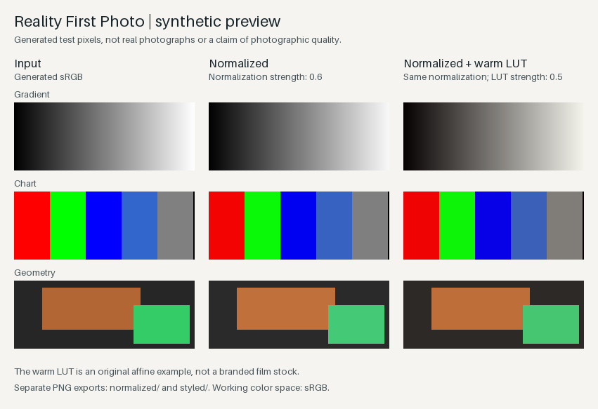

# Reality First Photo

**在本机离线比较**原图参考、自然归一化、自己的 LUT，以及归一化与 LUT 的组合，由你决定采用哪一路。源图保持不变；LUT 指纹、强度和色彩决策会被记录，便于按选定配方重复处理。

当前 **0.1.0a4** 是 **Python 命令行预览版**，面向愿意使用终端、准备好受支持 RGB 图像和编码 sRGB 3D CUBE LUT 的用户。

[English](README.md) · [色彩契约](docs/COLOR_CONTRACT.md) · [验证记录](VALIDATION.md) · [MIT 许可](LICENSE)



*用原创渐变、色卡和几何图形生成的三列静态演示：**Input（输入）→ Normalized（归一化 0.6）→ Normalized + warm LUT（暖色 LUT 强度 0.5）**。暖色 LUT 是原创简单变换，图中不含真实照片或商业预设。*

[短演示录制计划](docs/DEMO.md)——目前仅有计划，尚未发布视频。

## 快速开始：先看到结果

要求 **Python ≥3.12**。在 POSIX shell 中从 GitHub 安装，生成 demo、检查输入，再运行四路比较：

```sh
python3 -m venv .venv
. .venv/bin/activate
python -m pip install https://github.com/fgd2009/reality-first-photo/archive/refs/heads/main.zip
reality-first-photo demo --output first-look
reality-first-photo check --input first-look/input --lut first-look/demo_warm.cube --format png
reality-first-photo compare --input first-look/input --output first-compare --lut first-look/demo_warm.cube --normalize-strength 0.6 --lut-strength 1
```

打开 **`first-look/comparison.png`** 查看三列静态 demo；在允许本地文件访问的环境，打开 **`first-compare/index.html`** 查看四路报告和单张 PNG 链接。每次选择新的输出目录，已有输出不会被覆盖。无需 Git 仓库副本或测试工具，安装后可在源码目录外运行。

可按[自愿试用引导](docs/TRYOUT.md#中文简要与反馈)检查结果：快速开始只运行一次，随后查看已经生成的文件。

安装会下载依赖；图像处理在本地完成，没有遥测、模型调用、账号登录或上传。CLI 不调用外部 EXIF 工具，也不读取个人偏好。

**预览边界：**由你选择偏好，程序不会给图像打分或自动选优。证据限于合成输入和[验证记录](VALIDATION.md)中的检查，不代表真实照片质量或物理胶片准确性；尚未完成独立用户试用。RAW、完整 GUI 和原生应用安装包不在当前范围内；跨平台行为与真实浏览器效果仍未验证。详见[支持限制](#支持范围与限制)和[浏览器检查状态](docs/TROUBLESHOOTING.md#pending-manual-html-visual-check)。

## 比较四条处理路径

上面的快速开始命令复用了 demo 生成的合成图与原创暖色 LUT。

`check` 会真实解码输入，显示 ready、blocked、ignored 各项和 ICC 决策，不写文件、不调用外部 EXIF 工具；加 `--json` 可将机器可读报告打印到终端。检查时采用准备处理的格式、尺寸和显式 sRGB 假设。检查不会锁定输入，也不保证之后运行时文件仍未改变。

**用浏览器打开 `first-compare/index.html`**，逐张比较四路 PNG 预览：

| 路径 | 处理内容 |
| --- | --- |
| 原图 / 输入参考 | 解码、转换到工作 sRGB、按指定尺寸缩放后导出 PNG；并非源文件的原样副本。 |
| 仅归一化 | 在输入参考上执行归一化。 |
| 仅 LUT | 在输入参考上应用所选 LUT，不执行归一化。 |
| 归一化 + LUT | 先归一化，再应用所选 LUT。 |

报告不会默认选出最佳结果。可以通过图片旁的链接单独打开/保存导出图，并展开详情检查各路强度、实际归一化操作和 ICC 决策。默认归一化强度为 0.6、LUT 强度为 1、预览长边为 2048；可通过 `--normalize-strength`、`--lut-strength` 和 `--max-long-edge` 调整。比较结果固定导出为**附带工作 sRGB ICC 的 8 位 PNG**。

处理自己的图片时，将 `--input`、`--lut` 换为本地路径，并选择新的输出目录。`compare` 必须指定受支持的 LUT。RAW、未知或不受支持的 ICC 输入仍会被拒绝；`--assume-srgb` 仅用于明确声明已确认是编码 sRGB 的无标签像素。

本地报告由 `index.html`、`compare.json` 和四个图片文件夹组成，包含输入文件名及哈希、LUT 信息和派生图像；程序不会上传它们。移动报告时请保留整个文件夹，确保相对图片链接有效。命令不会自动启动浏览器或服务器。必须以 `compare.json` 的 `complete` 状态判断完成；强制终止可能在最终清单提交前留下 HTML，不能仅凭页面存在认定成功。

每一路都从同一输入解码后的工作像素独立开始，再量化导出 PNG；不会把参考 PNG 再送入另一条处理路径。输入符号链接（包括文件夹内的链接）、已有输出路径和输入树内的输出都会被拒绝。程序在各路之间和完成前复核受支持输入的名称、内容及 LUT 字节；检测到变化则保留失败记录，不生成成功页面。这是变化检测，不是不可变文件快照。

Python 调用可使用 `reality_first_normalization.compare.run_comparison(source, output, lut_path, ...)`，路径参数使用 `Path`。成功返回 0，处理失败返回 2，取消返回 130；前置参数或路径不合法时，会在创建输出前抛出 `ValueError` 或 `OSError`。

### 导出自己选中的路径

观察比较结果后自行选一路，从原始输入重新运行普通导出命令，保持报告中记录的**实际强度、LUT、预览尺寸和色彩假设一致**。只有当你在上例中选择了组合路径时，才使用下面这个例子：

```sh
reality-first-photo --input first-look/input --output chosen-tiff --lut first-look/demo_warm.cube --normalize-strength 0.6 --lut-strength 1 --max-long-edge 2048 --format tiff
```

仅归一化时省略 LUT；仅 LUT 时把归一化强度设为零；输入参考则两者都不应用。如果你的比较参数不同，应使用自己的实际记录。TIFF 为 16 位，比较 PNG 为 8 位；不要把导出的参考 PNG 回灌到处理流程。详见[路径对应与恢复说明](docs/TROUBLESHOOTING.md#export-the-route-you-chose)。

## 处理自己的图像

```sh
reality-first-photo --input /path/to/tagged-images --output /path/to/new-output --lut /path/to/your.cube --normalize-strength 0.6 --lut-strength 1 --format tiff
```

使用具有适当授权、面向**编码 sRGB**制作的 LUT。归一化先执行，之后由用户 LUT 的表格定义效果，不再套用另一种风格。将 `--normalize-strength` 设为 `0` 可跳过归一化；省略 `--lut` 则只归一化。两个强度参数均为 0 到 1；`--lut-strength 0` 不混入 LUT 效果，但仍检查已指定的 LUT 文件。LUT 缺失会明确报错。

默认预览长边为 2048 像素。用 `--max-long-edge 0` 明确保留原尺寸；解码发生在缩放之前，大图内存占用和性能尚未验证。

每次运行都需选择**新的输出目录**；已有目录会被拒绝，输出也不能位于输入文件夹内部。文件夹输入会递归查找 JPEG、PNG、TIFF；如发现已知 RAW 扩展名，整次运行会在创建输出前报错；其他扩展名会被忽略。`manifest.json` 记录运行状态、完成文件、输入哈希和色彩决策。每个文件还记录 `normalization.applied` 和 `normalization.operations`；执行归一化时，后者包含实际的 `exposure_scale` 与 `white_balance_gains_rgb`。这些是计算得到的处理参数，不是照片质量评分。失败或取消时保留部分输出，并记录当前/失败的相对文件名和处理阶段；修正原因后换新目录重试。强制终止可能留下 `running` 或没有最终记录，应视为未完成。验证包含注入中断，以及 Linux 上在受控处理检查点发送的真实 SIGINT/SIGTERM 信号；实体键盘和 GUI 行为仍未验证。

## 遇到错误时

| 提示或情况 | 下一步 |
| --- | --- |
| 输出目录已经存在 | 换用新目录，例如 `--output first-look-2`，已有输出会保留。 |
| 新输入缺少 ICC，或 ICC 无效 | 在可信色彩管理工具中重新导出带标签的 RGB sRGB。仅当无标签像素已确认是编码 sRGB 时使用 `--assume-srgb`；它不能绕过损坏的 ICC。 |
| 找不到 CUBE LUT | 更正 `--lut` 路径，指向自己的受支持 CUBE 文件。普通图像处理命令可在仅需归一化时省略 `--lut`；`compare` 必须指定该参数。 |

[故障恢复说明](docs/TROUBLESHOOTING.md)包含只读检查、状态解读和待执行的合成图 HTML 手动视觉检查。受管开发环境的真实浏览器效果仍未验证：本地文件导航返回 `ERR_BLOCKED_BY_ADMINISTRATOR`。不要绕过该策略；HTML 结构测试不等于浏览器视觉验收。

## 支持范围与限制

| 输入或操作 | 当前预览行为 |
| --- | --- |
| RGB8 JPEG、PNG | 通过 LittleCMS 将有效 RGB ICC 转换至工作 sRGB；拒绝动画和多帧图像，包括 APNG。 |
| TIFF | 仅无压缩、单页、逐像素 RGB；支持 8/16 位整数或范围受限的 float32。 |
| 高位深 TIFF 的 ICC | 仅接受与内置工作 ICC 完全相同的配置，或无 ICC 且显式声明为 sRGB 的数据；不支持任意高位深 ICC 转换。 |
| 无 ICC 输入 | 默认拒绝；只有确认像素已是编码 sRGB 时，才使用 `--assume-srgb`。该参数不能绕过损坏的内嵌 ICC。 |
| 缩放与导出 | float32 分通道缩放；导出 16 位 TIFF 或 8 位 PNG/JPEG，均附工作 ICC。JPEG 为有损格式。 |
| LUT | 红轴最快的 3D CUBE，三线性插值、有限正域宽、输出节点位于 [0,1]；支持默认域和 `DOMAIN_MIN`/`DOMAIN_MAX`；拒绝未知指令、1D/组合表和 `LUT_3D_INPUT_RANGE`，不自动推断 log/HDR 转换。 |

RAW/DNG、灰度、CMYK、alpha/透明色键、16 位 PNG、压缩或多页 TIFF、打包位深 TIFF、非默认 TIFF 方向均会被拒绝。完整 GUI、商业预设和原生应用安装包不在本预览范围内。尚未验证真实照片、真实 RAW、商业 LUT、物理胶片准确性或跨平台行为。

## 开发与验证

```sh
git clone https://github.com/fgd2009/reality-first-photo.git
cd reality-first-photo
python3 -m venv .venv
. .venv/bin/activate
python -m pip install -e '.[test]' build
python -m pytest -q tests
python -m build
```

原有 `--input` / `--output` 图像处理命令继续可用。在源码目录运行 `python -m examples.generate_demo demo-assets`，仍可只生成原始合成图和示例 LUT，不执行处理。

[CI 工作流](.github/workflows/ci.yml) 使用 Ubuntu / Python 3.12 运行当前候选测试，构建软件包，在独立环境安装 wheel，并从源码目录之外运行完整演示和四路比较；不会自动发布到 PyPI。当前执行结果和未验证项见 [VALIDATION.md](VALIDATION.md)。历史大型恢复副本的测试数不计入此仓库覆盖数。

[路线图](ROADMAP.md)先保证可靠跑通全流程，再进入[自愿本地试用](docs/TRYOUT.md)。小组探索门槛是拟定标准，不是已收集到的用户结果；本工作不包含主动群发或自动选出最佳图像。

## 许可

原创项目代码与演示生成器以 [MIT 许可](LICENSE)发布，版权归 2026 fgd2009。依赖保留各自许可证；生成的工作 ICC 保留其自由使用声明，详见 [THIRD_PARTY_NOTICES.md](THIRD_PARTY_NOTICES.md)。用户提供的 LUT 仍受其自身许可约束。
